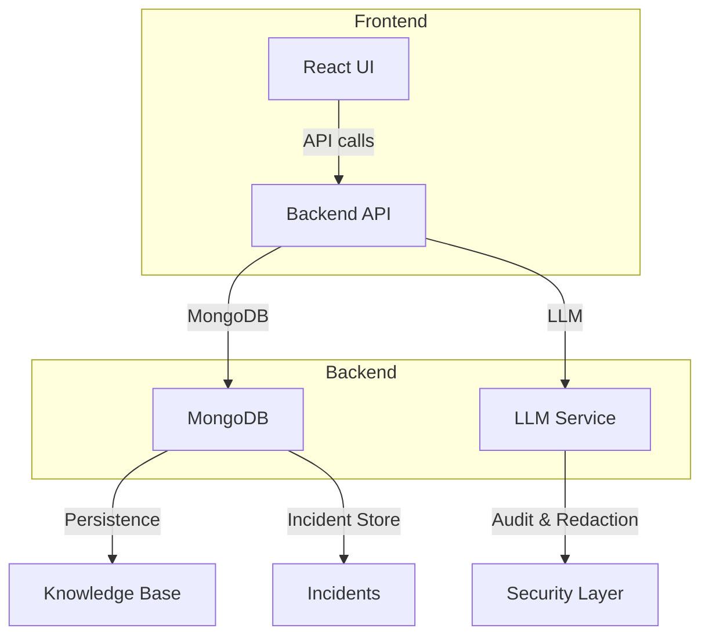

# DevMemory

## Project Overview
DevMemory is an AI‑powered developer‑memory platform that captures, diagnoses, and reuses historical incident data across projects. It helps developers quickly understand recurring errors, retrieve relevant knowledge‑base entries, and verify fixes with trusted evidence.

## Key Features
- **Incident capture & diagnosis** – Automatic error detection, stack‑trace extraction, and AI‑generated recommendations.
- **Historical incident retrieval** – Search past incidents by error type, project, or code snippet.
- **Project memory & knowledge‑base** – Stores curated knowledge entries linked to incidents.
- **Verified‑fix tracking** – Records command runs, exit codes, and evidence; only marks a fix as verified when trusted evidence is provided.
- **Command‑run history & analytics** – Persists command execution metadata for regression analysis.
- **LLM request auditing & secret redaction** – Scrubs secrets (API keys, DB URIs) before any network transmission.
- **Project isolation & security controls** – Enforces path‑boundary containment and per‑project configuration.
- **Frontend UI for verification** – `VerifyFixModal.jsx` provides a safe UI for submitting verification evidence.

> **Note:** Some UI components (e.g., Performance Lab, Workspaces) have been removed from the sidebar in the latest integration.

## Architecture

- **Frontend:** React + Vite, uses `devmemoryApi` to interact with backend routes.
- **Backend:** FastAPI (Python) exposing routes for incidents, fixes, command runs, and project configuration.
- **Persistence:** MongoDB collections (`incidents`, `knowledge_base`, `command_runs`, `projects`).
- **AI Integration:** Calls to LLM providers for diagnostics and suggestions, with automatic secret redaction.

## Technology Stack
- **Languages:** Python 3.9+, JavaScript (ES2022)
- **Frontend:** React, Vite, TailwindCSS, Lucide‑React icons
- **Backend:** FastAPI, Pydantic, Motor (async MongoDB driver)
- **Database:** MongoDB (local or remote URI via `MONGODB_URI`)
- **AI/LLM:** OpenAI / compatible LLM endpoint (configurable via env)
- **Testing:** Pytest (backend), Vitest (frontend)
- **Package Management:** Poetry / pip for Python, npm for frontend

## Repository Structure
```
DevMemory/
├─ frontend/                # React UI
│   ├─ src/                 # Components, pages, API client
│   └─ dist/                # Production build output
├─ server/                  # FastAPI backend
│   ├─ app/                 # API routes, models, services
│   └─ scripts/             # Maintenance utilities
├─ fixtures/                # Demo fixtures for CLI commands
├─ tests/                   # Pytest suite
├─ examples/security-demos/ # Example security demo scripts
├─ scratch/                 # User‑generated helper scripts (not versioned)
├─ .gitignore
├─ pyproject.toml
└─ README.md                # This documentation
```

## Prerequisites
- **Node.js** ≥ 18 (for frontend)
- **Python** ≥ 3.9 (virtual environment recommended)
- **MongoDB** instance (local or remote). Set `MONGODB_URI` env variable.
- **LLM API key** (optional, for AI diagnostics). Set `OPENAI_API_KEY` or equivalent.

## Configuration
Create a `.env` file (git‑ignored) with:
```
MONGODB_URI=mongodb://localhost:27017/devmemory
OPENAI_API_KEY=your‑api‑key‑here   # optional
```
Never commit real secrets.

## Installation & Local Setup
```bash
# Clone the repo (already done)
cd DevMemory
# Backend setup
default:
python -m venv .venv
source .venv/Scripts/activate   # PowerShell: .\.venv\Scripts\Activate.ps1
pip install -e "[dev]"
# Frontend setup
cd frontend
npm install
```

## Running the Application
```bash
# Start backend (default port 8000)
uvicorn server.app.main:app --reload
# In another terminal, start frontend
cd frontend
npm run dev   # dev server at http://localhost:5173
# Or build for production
npm run build && npx serve -s dist
```
The frontend expects the backend at `http://localhost:8000` (configurable via `VITE_BACKEND_URL`).

## API Overview
| Method | Path | Purpose |
|--------|------|---------|
| `POST` | `/api/projects` | Register a new project (creates `project_id`). |
| `GET`  | `/api/projects/{project_id}` | Retrieve project configuration. |
| `POST` | `/api/incidents` | Record a new incident (error type, stack trace). |
| `GET`  | `/api/incidents/{incident_id}` | Fetch incident details. |
| `POST` | `/api/fixes` | Create a fix proposal for an incident. |
| `POST` | `/api/fixes/{fix_id}/verify` | Submit verification evidence (command, exit code, event_id). |
| `GET`  | `/api/runs/project/{project_id}` | List recent command runs (used by `VerifyFixModal`). |

## Testing
```bash
# Backend unit & integration tests
pytest -q
# Frontend lint & build check
npm run build   # already succeeded above
```
The deliberately failing `examples/security-demos/test_failure.py` is **not** part of the test suite.

## Security & Data Safety
- All environment variables are loaded from a `.env` file and never committed.
- `devmemoryApi` strips any detected secrets from logs before sending to the backend.
- MongoDB URIs are redacted in responses; the client only sees a placeholder.
- `VerifyFixModal` requires explicit evidence (command, details, or event_id) before marking a fix verified.
- No `.env` or credential files are included in the repository.

## Demo & Troubleshooting
- **Security demo:** `examples/security-demos/test_failure.py` triggers a division‑by‑zero error to show error capture.
- **Common issues:**
  - *MongoDB connection error*: Ensure `MONGODB_URI` is correct and MongoDB is running.
  - *Backend unreachable*: Frontend will still show local diagnostics; check network settings.
  - *Large frontend bundles*: See build warnings; consider code‑splitting.

## Known Limitations & Roadmap
- Large production bundles (>500 KB) – need code‑splitting.
- UI still lacks dark‑mode toggle (future enhancement).
- Automated CI verification of fixes is pending.
- Additional LLM provider support planned.

## Contributing
1. Fork the repo.
2. Create a feature branch.
3. Ensure `git diff --check` passes and tests succeed.
4. Open a PR.

## License
See `LICENSE` file.
